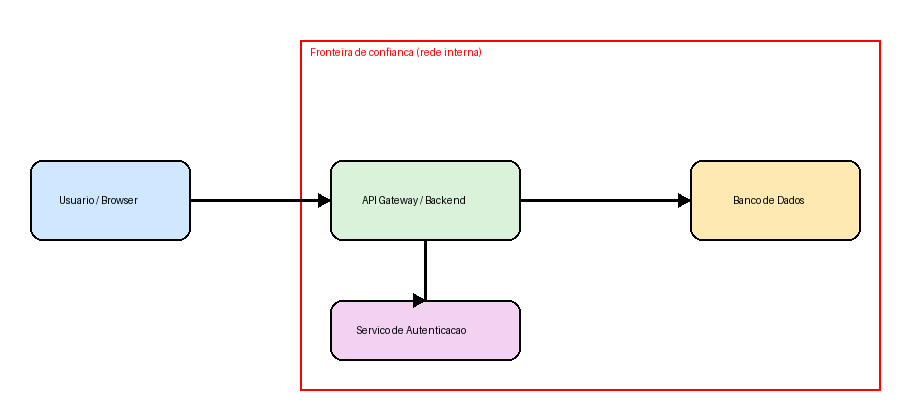
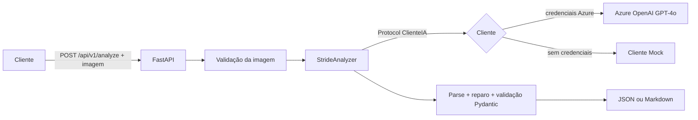

# 🛡️ STRIDE Threat Modeling API


API em **Python + FastAPI + Azure OpenAI** que recebe a **imagem de um diagrama de arquitetura** e gera automaticamente uma **análise de ameaças com a metodologia STRIDE**, usando *prompt engineering* com um modelo multimodal (GPT-4o).

> Projeto do desafio DIO. Vai além do exigido: validação estrita da saída da IA, cliente com retry, modo mock automático, exportação em Markdown, CLI para CI/CD, métricas Prometheus, Docker hardenizado e testes automatizados.

## 🖼️ Exemplo

Diagrama de entrada (`images/exemplo_diagrama.png`):



Relatório gerado: [`docs/exemplos/exemplo_diagrama.md`](docs/exemplos/exemplo_diagrama.md)

## 🧠 O que é STRIDE

| Letra | Ameaça | Pergunta-chave |
|---|---|---|
| **S** | Spoofing | Alguém pode se passar por outra identidade? |
| **T** | Tampering | Dados ou código podem ser adulterados? |
| **R** | Repudiation | Uma ação pode ser negada por falta de rastro? |
| **I** | Information Disclosure | Dados sensíveis podem vazar? |
| **D** | Denial of Service | O componente pode ser derrubado? |
| **E** | Elevation of Privilege | Alguém pode obter mais permissões que o devido? |

## 🏗️ Arquitetura



Detalhes e decisões de projeto em [ARCHITECTURE.md](ARCHITECTURE.md).

## ✨ Diferenciais de engenharia

- **Prompt engineering versionável** (`app/services/prompts.py`): papel de especialista, metodologia passo a passo, schema JSON injetado no prompt, exigência de mitigações concretas.
- **Saída da IA nunca é confiada cegamente**: validada por schema Pydantic; se o modelo devolver JSON dentro de markdown, há reparo automático; se ainda assim inválido, erro de domínio claro (422).
- **Inversão de dependência**: o analisador depende de um `Protocol` (`ClienteIA`), não do SDK da Azure.
- **Modo mock automático**: sem credenciais Azure, a API roda e responde com o mesmo contrato. Qualquer pessoa testa em 1 minuto, sem custo.
- **Resiliência**: retry com backoff exponencial (tenacity) para 429/timeout/conexão; falhas do provedor viram 502.
- **Segurança**: autenticação opcional por `X-API-Key`, limite de tamanho de upload, validação real do conteúdo da imagem (não só do content-type), rate limiting, container não-root com filesystem somente leitura.
- **Observabilidade**: logs JSON com `request_id`, header `X-Request-ID`, métricas Prometheus em `/metrics`, health check.
- **Automação**: exportação em Markdown (`?formato=markdown`) e CLI de análise em lote para pipelines de CI/CD.
- **Qualidade**: 15 testes, lint com ruff, CI em Python 3.11/3.12 e build Docker.

## 🚀 Como executar

```bash
git clone https://github.com/josewagnerbljr-sys/desafio-dio-stride-threat-modeling.git
cd desafio-dio-stride-threat-modeling
python -m venv .venv && source .venv/bin/activate   # Windows: .venv\Scripts\activate
make install        # ou: pip install -r requirements-dev.txt
cp .env.example .env
make run            # ou: uvicorn app.main:app --reload
```

Abra a documentação interativa: **http://localhost:8000/docs**

Sem credenciais Azure a API sobe em **modo mock**. Para usar a Azure OpenAI real, preencha no `.env`:

```env
AZURE_OPENAI_ENDPOINT=https://SEU-RECURSO.openai.azure.com/
AZURE_OPENAI_API_KEY=sua-chave
AZURE_OPENAI_DEPLOYMENT=gpt-4o
```

### Docker

```bash
docker compose up --build
```

## 📡 Uso da API

```bash
# Resposta JSON
curl -X POST "http://localhost:8000/api/v1/analyze" \
  -F "arquivo=@images/exemplo_diagrama.png"

# Relatório em Markdown
curl -X POST "http://localhost:8000/api/v1/analyze?formato=markdown" \
  -F "arquivo=@images/exemplo_diagrama.png"

# Com autenticação (quando API_KEY está definida)
curl -X POST "http://localhost:8000/api/v1/analyze" \
  -H "X-API-Key: sua-chave" -F "arquivo=@images/exemplo_diagrama.png"
```

| Endpoint | Descrição |
|---|---|
| `POST /api/v1/analyze` | Analisa o diagrama (`arquivo`, `prompt` opcional, `formato=json\|markdown`) |
| `GET /api/v1/health` | Status e modo do cliente de IA |
| `GET /metrics` | Métricas Prometheus |

| Código | Significado |
|---|---|
| 200 | Análise concluída |
| 401 | API key ausente/inválida |
| 413 | Arquivo acima do limite |
| 422 | Arquivo inválido ou resposta da IA fora do schema |
| 429 | Rate limit excedido |
| 502 | Provedor de IA indisponível |

### Análise em lote (CI/CD)

```bash
python scripts/analisar_lote.py pasta_com_diagramas/ --saida relatorios/
```

## ✅ Testes e qualidade

```bash
make test    # 15 testes
make lint    # ruff
```

## 📂 Estrutura

```
app/
├── main.py                    # montagem da app, middlewares, métricas
├── core/                      # config, logging JSON, exceções, segurança
├── api/                       # deps (injeção) e endpoints v1
├── schemas/threat_model.py    # contratos Pydantic (STRIDE)
├── services/                  # prompts, clientes IA (Azure/mock), analyzer, renderer
└── utils/image_utils.py       # validação da imagem
scripts/                       # gerador de diagrama e CLI em lote
tests/                         # pytest
```

## 🗺️ Próximos passos

Azure AD/OAuth2 no lugar da API key, Azure Key Vault para segredos, cache por hash de imagem, fila assíncrona para análises longas e few-shot com diagramas rotulados.

## 📚 Contexto

Desafio da DIO: API com Python, FastAPI e Azure OpenAI para análise STRIDE de diagramas de arquitetura. Referência: [digitalinnovationone/stride-demo](https://github.com/digitalinnovationone/stride-demo).

## 📄 Licença

MIT
